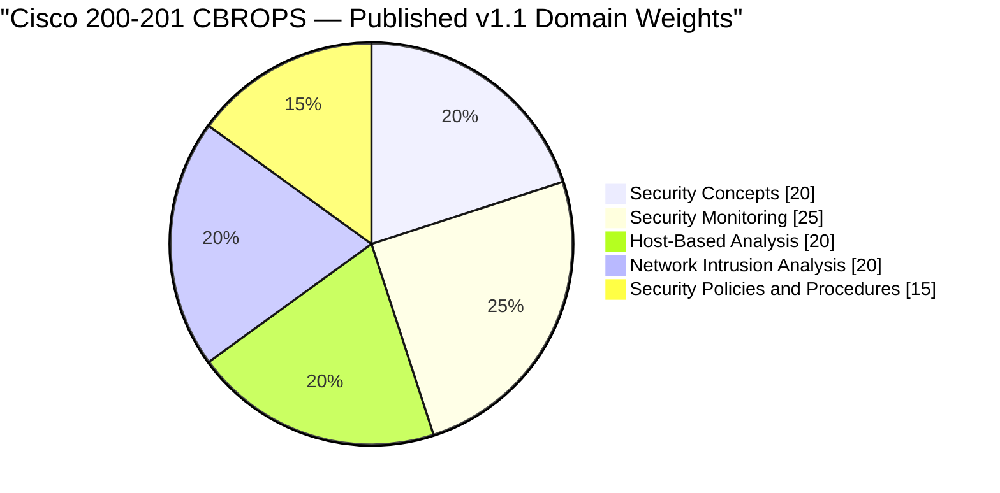
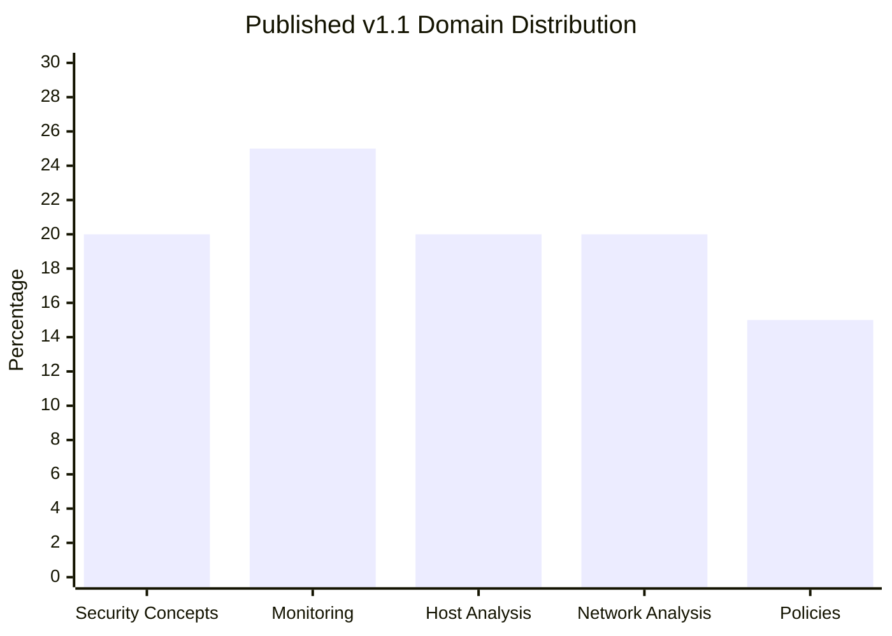
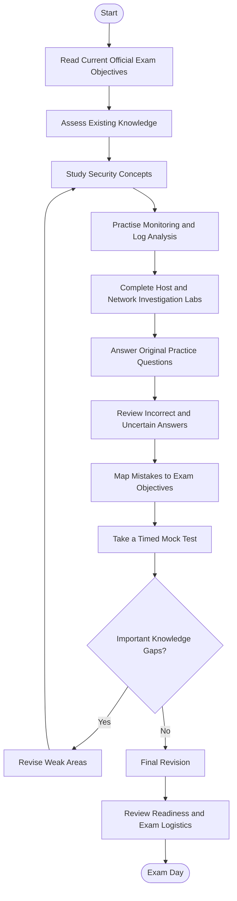
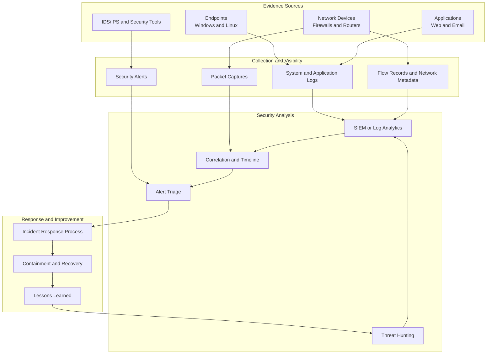
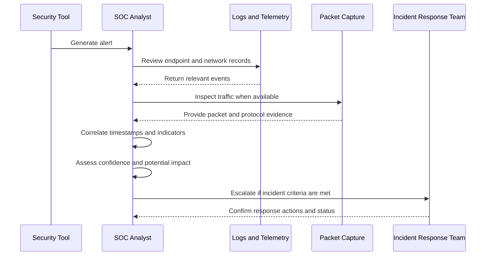
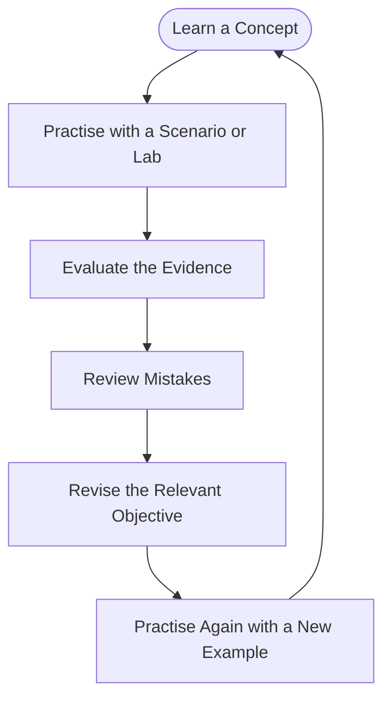
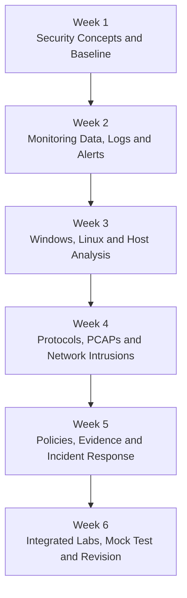

# Cisco 200-201 CBROPS Study Guide — CCNA Cybersecurity

A practical study guide for **Cisco 200-201 CCNACBR (Understanding Cisco Cybersecurity Operations Fundamentals)**, the core exam for the **CCNA Cybersecurity** certification.

This repository organizes the exam's major knowledge areas into a structured learning path: security concepts, security monitoring, host-based analysis, network intrusion analysis, and security policies and procedures. It includes technical diagrams, original practice questions, investigation exercises, suggested labs, and links to official Cisco resources.

> **Current exam version:** Cisco identifies 200-201 CCNACBR v1.2 as the current exam.  
> **Official exam page:** [Understanding Cisco Cybersecurity Operations Fundamentals](https://www.cisco.com/site/us/en/learn/training-certifications/exams/ccnacbr.html)  

---

## Table of Contents

- [Overview](#overview)
- [About the Certification](#about-the-certification)
- [Who Should Prepare?](#who-should-prepare)
- [Exam Information](#exam-information)
- [Exam Objectives and Knowledge Areas](#exam-objectives-and-knowledge-areas)
- [Exam Domain Weightage](#exam-domain-weightage)
- [Preparation Flowchart](#preparation-flowchart)
- [Security Operations Architecture](#security-operations-architecture)
- [Security Investigation Workflow](#security-investigation-workflow)
- [Circular Study and Revision Cycle](#circular-study-and-revision-cycle)
- [Step-by-Step Preparation Guide](#step-by-step-preparation-guide)
- [Suggested Study Roadmap](#suggested-study-roadmap)
- [Practice Questions](#practice-questions)
- [Hands-On Labs and Practical Projects](#hands-on-labs-and-practical-projects)
- [Common Preparation Mistakes](#common-preparation-mistakes)
- [Career Relevance](#career-relevance)
- [Frequently Asked Questions](#frequently-asked-questions)
- [Official and Additional Resources](#official-and-additional-resources)
- [About CertsGate](#about-certsgate)

---

## Overview

Cybersecurity operations teams monitor systems, identify suspicious activity, investigate alerts, and coordinate responses to security incidents. A security operations analyst needs to understand both the technical evidence and the operational process used to assess it.

The Cisco 200-201 exam tests foundational knowledge across five broad areas:

- **Security concepts:** risk, vulnerabilities, threats, access control, cryptography, and security architecture.
- **Security monitoring:** network telemetry, security logs, attack patterns, certificates, and monitoring technologies.
- **Host-based analysis:** endpoint security, Windows and Linux artifacts, operating system logs, and evidence.
- **Network intrusion analysis:** packet captures, protocols, traffic flows, alerts, and intrusion indicators.
- **Security policies and procedures:** incident handling, evidence preservation, asset management, security operations, and response processes.

This Cisco 200-201 study guide is designed to help learners connect those subjects. The objective is not simply to memorize terms; it is to explain what evidence means, recognize what a tool can and cannot show, and choose a sensible next step when investigating a potential incident.

## About the Certification

Cisco's current exam listing identifies the exam as **Understanding Cisco Cybersecurity Operations Fundamentals (200-201 CCNACBR)**. Passing the exam earns the **CCNA Cybersecurity** certification.

The exam covers foundational skills for cybersecurity operations, including security monitoring, host-based analysis, network intrusion analysis, and security policies and procedures. Cisco's associated training is intended for learners preparing for associate-level cybersecurity analyst responsibilities in a security operations center (SOC).

Official links:

- [Cisco 200-201 exam details](https://www.cisco.com/site/us/en/learn/training-certifications/exams/ccnacbr.html)
- [Cisco CCNA Cybersecurity certification](https://www.cisco.com/site/us/en/learn/training-certifications/certifications/cybersecurity/ccna-cybersecurity/index.html)
- [Cisco official training course](https://www.cisco.com/site/us/en/learn/training-certifications/training/courses/ccnacbr.html)

## Who Should Prepare?

This exam may be useful for:

- People beginning a career in cybersecurity operations.
- Junior SOC analysts learning to investigate alerts.
- IT support and network professionals moving toward security work.
- Learners interested in log analysis, packet inspection, and incident response.
- Students who want structured coverage of core security monitoring concepts.
- Candidates seeking the CCNA Cybersecurity certification.

Cisco lists no formal prerequisites for the exam. However, familiarity with Ethernet and TCP/IP, basic security concepts, and Windows and Linux will make the technical topics easier to understand.

If you are new to networking, review IP addressing, DNS, TCP and UDP, common ports, routing, and basic command-line use before starting detailed intrusion analysis.

---

## Exam Information

| Item | Details |
|---|---|
| Exam code | 200-201 CCNACBR |
| Exam name | Understanding Cisco Cybersecurity Operations Fundamentals |
| Provider | Cisco |
| Current version listed | v1.2 |
| Certification earned | CCNA Cybersecurity |
| Exam duration | 120 minutes |
| Language listed | English |
| Price listed by Cisco | US$300 or Cisco Learning Credits |
| Formal prerequisites | None listed |
| Question count | Not stated here because a current official count was not verified |
| Numerical passing score | Not stated here; Cisco describes the result as pass/fail |

Cisco's certification information says the credential is valid for three years and that exam results are available online within 48 hours. Confirm current policies and registration details directly with Cisco before booking.

Official source: [Cisco 200-201 exam page](https://www.cisco.com/site/us/en/learn/training-certifications/exams/ccnacbr.html)

---

## Exam Objectives and Knowledge Areas

Cisco's exam blueprint is the authoritative checklist for preparation. The following sections summarize the major technical subjects and are intended to help organize study, not replace the official objectives.

### 1. Security Concepts

Understand the basic principles that guide security decisions.

Study:

- Confidentiality, integrity, and availability (CIA triad).
- Security deployments for networks, endpoints, applications, cloud environments, and virtual systems.
- Threats, vulnerabilities, exploits, and risk.
- Defense in depth and least privilege.
- Zero trust and threat modeling.
- Threat intelligence, threat hunting, and malware analysis.
- Rule-based, behavioral, and statistical detection.
- Access control models, including role-based and attribute-based access control.
- CVSS terminology and vulnerability severity factors.
- Security visibility across networks, endpoints, and cloud environments.

**Practical focus:** Given a security scenario, identify the asset, the threat or vulnerability, the potential impact, and the control that may reduce risk.

### 2. Security Monitoring

Learn how security tools collect evidence and how analysts interpret it.

Study:

- TCP dump and packet capture tools.
- NetFlow and other network telemetry.
- Traditional stateful firewalls and next-generation firewalls.
- Application visibility and control.
- Web and email content filtering.
- Full packet capture, session data, transaction data, metadata, statistical data, and alert data.
- Network attacks, denial of service, man-in-the-middle attacks, and web application attacks.
- Social engineering, malware, ransomware, command and control, and evasion techniques.
- TLS-related concepts, certificates, public key infrastructure (PKI), cipher suites, and key exchange.
- How NAT, tunneling, encryption, proxies, and encapsulation affect visibility.

**Practical focus:** Know which evidence source can answer a question and what it cannot prove. For example, flow records can reveal communication patterns, while a packet capture may provide protocol details and payload information when the traffic is observable and not encrypted.

### 3. Host-Based Analysis

Focus on evidence collected from endpoints and operating systems.

Study:

- Host-based intrusion detection.
- Antivirus and antimalware.
- Host-based firewalls and application allowlisting or blocklisting.
- Sandboxing.
- Windows and Linux operating system components.
- System, application, and command-line logs.
- Indicators of compromise (IoCs) and indicators of attack (IoAs).
- Asset and threat actor attribution.
- Chain of custody and evidence types.
- Disk-image integrity and malware analysis reports.
- Hashes, URLs, processes, and system events.

**Practical focus:** Build a timeline from endpoint events, explain what each artifact indicates, and separate direct evidence from assumptions.

### 4. Network Intrusion Analysis

This area emphasizes the interpretation of network traffic and intrusion-related evidence.

Study:

- IDS/IPS, firewall, proxy, antivirus, and application-control events.
- True positives, false positives, true negatives, false negatives, and benign activity.
- Deep packet inspection, packet filtering, and stateful firewall operation.
- Inline monitoring versus passive traffic monitoring.
- Packet capture analysis with Wireshark.
- TCP streams and file extraction where supported and authorized.
- Ethernet, IPv4, IPv6, TCP, UDP, ICMP, DNS, HTTP/HTTPS, email protocols, and ARP.
- Source and destination addresses, ports, protocols, payloads, hashes, and URLs.
- Basic regular expressions.

**Practical focus:** Practise reading packet captures and correlating timestamps, IP addresses, ports, protocol behavior, and security alerts.

### 5. Security Policies and Procedures

Understand how technical investigations fit into an organization's security process.

Study:

- Asset, configuration, mobile device, patch, and vulnerability management.
- Incident response plans and incident handling.
- Preparation, detection and analysis, containment, eradication, recovery, and post-incident review.
- Evidence collection order, data integrity, data preservation, and volatile data.
- Network and server profiling.
- Sensitive data categories such as personal information, protected health information, and intellectual property.
- Cyber Kill Chain and Diamond Model concepts.
- SOC performance measures such as time to detect and time to respond.
- Roles and responsibilities during incident handling.

**Practical focus:** Given an incident scenario, identify the next appropriate response step and explain how evidence should be preserved.

For the exact current objectives, consult Cisco's [200-201 exam information](https://www.cisco.com/site/us/en/learn/training-certifications/exams/ccnacbr.html) and the exam-topics link provided through Cisco's official exam resources.

---

## Exam Domain Weightage

Cisco's published CBROPS v1.1 exam-topics document lists the following five domain weights. Cisco currently identifies the exam as v1.2, and its published minor-update document describes objective changes for that version. The official sources available for this guide did not establish a separate v1.2 weight table, so **the percentages below are clearly identified as the published v1.1 distribution, not independently confirmed v1.2 weights**.

### Published v1.1 distribution

| Published v1.1 domain | Weight |
|---|---:|
| Security Concepts | 20% |
| Security Monitoring | 25% |
| Host-Based Analysis | 20% |
| Network Intrusion Analysis | 20% |
| Security Policies and Procedures | 15% |
| **Total** | **100%** |

Sources:

- [Cisco published 200-201 CBROPS v1.1 exam-topics PDF](https://learningcontent.cisco.com/documents/marketing/exam-topics/200-201-CBROPS-v1.1.pdf)
- [Cisco exam-version minor update document](https://learningcontent.cisco.com/documents/marketing/exam-topics/CyberOps_v1.2_Minor_Update.pdf)

### How to use this chart

Use the published percentages as a planning reference only, while verifying the current v1.2 objectives directly with Cisco. Do not assume that a previous version's weighting is guaranteed to remain unchanged.

Regardless of weighting, avoid skipping a domain. Security monitoring, host analysis, and network analysis overlap in real investigations: an alert may lead to a packet capture, which leads to endpoint logs, followed by a response decision.

---

## Preparation Flowchart

This preparation workflow turns the exam blueprint into a repeating learning process. If a mock test reveals a meaningful gap, return to the corresponding topic rather than simply taking more tests.

This is an independent study recommendation, not an official Cisco examination procedure.

## Security Operations Architecture

A security operations center combines data from endpoints, network devices, applications, and security tools. Analysts use that information to detect suspicious activity, investigate alerts, and coordinate response.

The following is a **conceptual SOC architecture**, not a required Cisco product deployment.

### What each layer contributes

| Layer | Examples | Investigation value |
|---|---|---|
| Evidence sources | Endpoints, firewalls, applications, IDS/IPS | Generate observations about system and network activity |
| Collection | Logs, flow records, packet captures, alerts | Preserve different kinds of evidence |
| Analysis | SIEM, correlation, threat hunting, triage | Connect observations and prioritize suspicious events |
| Response | Incident handling, containment, recovery | Limit impact and restore normal operation |
| Improvement | Lessons learned, updated detections, playbooks | Reduce recurrence and improve future investigations |

A SIEM can correlate data from many sources, but it does not automatically make every alert accurate. Analysts still need to validate the evidence, check context, and distinguish malicious activity from legitimate behavior.

---

## Security Investigation Workflow

A useful investigation starts with an alert and develops a timeline from independent evidence sources. This simplified sequence illustrates the reasoning process.

When analysing an alert, ask:

1. What triggered the alert?
2. Which host, user, process, or network flow is involved?
3. What evidence supports the detection?
4. Are there alternative benign explanations?
5. Can independent data sources corroborate the activity?
6. What is the potential impact?
7. Which response step is appropriate, and what evidence must be preserved?

---

## Circular Study and Revision Cycle

Cybersecurity analysis is a practical skill. Repeating the cycle below helps turn definitions into reasoning you can apply to unfamiliar examples.

- **Learn:** Study one objective from reliable documentation.
- **Practise:** Use a lab, packet capture, log sample, or original question.
- **Evaluate:** Explain what the evidence demonstrates and what remains uncertain.
- **Review:** Identify the reasoning or technical detail you missed.
- **Revise:** Return to the relevant objective and documentation.
- **Practise again:** Confirm that you can apply the concept to a different example.

---

## Step-by-Step Preparation Guide

### Step 1: Build an objective checklist

Read the current Cisco exam topics. Mark each objective as comfortable, developing, or unfamiliar. This creates a personal study plan instead of a generic list of chapters.

### Step 2: Learn security fundamentals

Review the CIA triad, risk, threats, vulnerabilities, exploits, access control, cryptography, and defense in depth. Practise explaining how each concept applies to a realistic organization.

### Step 3: Understand monitoring data

Compare logs, alerts, NetFlow, metadata, session records, and packet captures. Learn what each source records, what may be missing, and how encryption or network design can limit visibility.

### Step 4: Study endpoint evidence

Review Windows and Linux fundamentals, processes, system logs, endpoint security controls, malware analysis output, and indicators of compromise. Learn to construct a timeline and preserve evidence.

### Step 5: Practise network intrusion analysis

Use authorized sample PCAPs to inspect DNS queries, TCP connections, HTTP behavior, address and port information, and suspicious traffic patterns. Practise using Wireshark display filters and basic command-line tools.

### Step 6: Learn incident response

Understand preparation, detection and analysis, containment, eradication, recovery, and lessons learned. Study why evidence integrity and chain of custody matter.

### Step 7: Test yourself with scenarios

Use practice questions to identify weak areas. For every incorrect answer, write down the relevant objective, why your answer failed, and what evidence would support the correct reasoning.

### Step 8: Reassess readiness

Take a timed practice test after covering the objectives. Review low-confidence answers even when they are correct. Before the exam, revise your notes and confirm current exam details with Cisco.

---

## Suggested Study Roadmap

This six-week schedule is an **independent example**, not a Cisco-mandated plan. Adjust the pace to your background, lab access, and progress.

| Week | Focus | Suggested deliverable |
|---|---|---|
| 1 | Security concepts, risk, access control, cryptography | A concise glossary with scenario examples |
| 2 | Logs, alerts, telemetry, SIEM, monitoring technologies | A table comparing data sources |
| 3 | Windows/Linux, endpoint controls, malware evidence | An endpoint investigation timeline |
| 4 | TCP/IP, DNS, packet captures, network alerts | A documented PCAP investigation |
| 5 | Incident response, evidence integrity, policies and procedures | An incident handling checklist |
| 6 | Mixed-domain practice, timed tests, weak-area review | A final readiness checklist |

A steady schedule with active recall and practical work is usually more useful than a last-minute attempt to memorize every term.

---

## Practice Questions

The following are **original educational practice questions** written for this repository. They are not actual, leaked, or official Cisco exam questions.

### Question 1: Security monitoring data

An analyst needs to understand which internal host communicated with an external IP address, which ports were involved, and how much traffic was exchanged. Which data source is a useful starting point?

A. NetFlow or comparable flow records  
B. A software inventory without network information  
C. A password policy document  
D. A file's desktop shortcut  

**Correct answer: A**

**Explanation:** Flow records commonly summarize communication endpoints, ports, protocols, and traffic volume. They may not contain the full packet payload, so a packet capture or other evidence may be needed for deeper analysis.

### Question 2: Host-based analysis

A Windows endpoint generates a suspicious process event shortly before an alert. What should an analyst do next?

A. Delete all event logs immediately  
B. Correlate the event with relevant process, user, timestamp, and other available evidence  
C. Assume that every unusual process is malware  
D. Reinstall every device on the network  

**Correct answer: B**

**Explanation:** A process event needs context. Correlating timestamps, process details, user activity, and related alerts helps determine whether the activity is suspicious and what additional evidence is required.

### Question 3: Packet analysis

A PCAP shows repeated DNS queries from a workstation to an unfamiliar domain. What is the most appropriate conclusion based on that fact alone?

A. The workstation is definitely compromised  
B. The domain is automatically safe because DNS responded  
C. The pattern warrants investigation, but additional context is needed to determine whether it is malicious  
D. DNS traffic cannot be used during security investigations  

**Correct answer: C**

**Explanation:** Repeated DNS queries can have benign or malicious causes. Check query patterns, domain context, response addresses, endpoint processes, timestamps, and related security events before reaching a conclusion.

### Question 4: Incident response

An analyst identifies a potentially compromised host. Why is evidence preservation important before taking investigative actions that may change the system?

A. It guarantees that the incident will not recur  
B. It can help preserve information needed to reconstruct events and support later analysis  
C. It makes all alerts accurate  
D. It removes the need to document response actions  

**Correct answer: B**

**Explanation:** Actions such as shutting down a host or deleting files may alter or destroy useful evidence. Follow the organization's procedures for containment and evidence collection, balancing preservation with the need to limit ongoing harm.

### Question 5: Detection quality

A security alert is triggered by activity that is later determined to be legitimate. How is this commonly classified?

A. True positive  
B. False positive  
C. True negative  
D. Data loss prevention  

**Correct answer: B**

**Explanation:** A false positive occurs when a detection identifies activity as malicious or suspicious when it is actually benign. Analysts should validate the event and, where appropriate, help improve detection logic without suppressing meaningful threats.

### How to get value from practice questions

For every question:

1. Explain why the correct answer fits the scenario.
2. Explain why each distractor is unsuitable.
3. Identify the relevant exam objective.
4. Read the related technical documentation.
5. Reproduce the concept with a lab or sample dataset when possible.
6. Try another question that tests the same skill in a different way.

A mock-test score is one readiness indicator, not a guarantee of exam performance.

---

## Hands-On Labs and Practical Projects

Use authorized lab systems, public educational datasets, or your own test environment. Do not inspect networks, capture other people's traffic, or execute suspicious files without appropriate authorization and safeguards.

### Lab 1: Explore security monitoring data

**Objective:** Understand the differences between logs, alerts, flow data, and packet captures.

Tasks:

- Collect a small set of sample system or network logs.
- Identify timestamps, source and destination addresses, ports, and event descriptions where available.
- Compare the information available in a flow record with a packet capture.
- Record which questions each data source can answer.

**Deliverable:** A data-source comparison table.

### Lab 2: Inspect a PCAP with Wireshark

**Objective:** Practise basic network intrusion analysis.

Tasks:

- Open an authorized sample PCAP.
- Identify relevant DNS, TCP, UDP, and HTTP or TLS activity.
- Inspect endpoint addresses and port numbers.
- Follow a TCP stream where appropriate.
- Record suspicious patterns without treating them as proof by themselves.
- Correlate observations with timestamps and any accompanying logs.

**Deliverable:** A short investigation report containing evidence, observations, and open questions.

### Lab 3: Review Windows and Linux evidence

**Objective:** Learn how endpoint events contribute to an investigation.

Tasks:

- Explore system and application logs on a test machine.
- Review running processes and network connections using appropriate system tools.
- Identify the user, process, timestamp, and event details relevant to a hypothetical incident.
- Build a simple event timeline.
- Record what information is missing.

**Deliverable:** An endpoint investigation checklist and timeline.

### Lab 4: Investigate a suspicious DNS pattern

**Objective:** Combine network evidence and contextual reasoning.

Tasks:

- Use an authorized sample dataset containing DNS records.
- Identify repeated queries, unusual timing, or unexpected destinations.
- Compare DNS events with available host or flow records.
- Consider benign explanations.
- State what additional evidence would strengthen or weaken the suspicion.

**Deliverable:** A documented hypothesis with supporting and conflicting evidence.

### Lab 5: Practise alert triage

**Objective:** Develop a repeatable process for evaluating security alerts.

Tasks:

- Choose a sample alert from an educational dataset.
- Identify the affected asset and the detection source.
- Collect relevant logs and telemetry.
- Determine whether the evidence is sufficient to classify the event.
- Document the next investigative action and escalation criteria.

**Deliverable:** A triage worksheet with evidence, confidence, impact, and next steps.

### Lab 6: Build an incident response playbook

**Objective:** Connect investigation findings to incident handling.

Tasks:

- Choose a hypothetical incident such as a suspected malware infection.
- Define initial triage steps.
- Identify evidence that should be preserved.
- Outline containment, eradication, and recovery actions.
- Specify who should be notified and what must be documented.
- Add a lessons-learned section.

**Deliverable:** A concise incident response playbook aligned with organizational procedures.

### Capstone project: Investigate a simulated security event

Build a small portfolio project that includes:

- A clearly defined incident scenario.
- Sample logs or an authorized PCAP.
- A timeline of relevant events.
- Network and endpoint observations.
- A distinction between facts, hypotheses, and unknowns.
- A recommended response path.
- Evidence-handling notes.
- A final report explaining how the conclusion was reached.

Keep the project reproducible and safe. Never publish credentials, private organizational data, or sensitive packet captures.

---

## Common Preparation Mistakes

### Memorizing terminology without applying it

Knowing definitions is helpful, but analysts also need to interpret evidence. Pair each major concept with an example or scenario.

### Treating a single alert as proof

An alert is a signal to investigate. Validate it with context, supporting evidence, and alternative explanations.

### Confusing logs, flow data, and packet captures

These sources have different levels of detail. Know which one can answer a particular question and what visibility limitations may apply.

### Ignoring Windows and Linux fundamentals

Host-based analysis depends on understanding processes, operating system behavior, and logs. Basic command-line familiarity helps when investigating suspicious activity.

### Skipping evidence integrity

Incident response is not only about identifying a threat. Preserve evidence appropriately, document actions, and follow authorized procedures.

### Taking repeated mock tests without reviewing mistakes

A test is most valuable when it reveals what you need to learn. Map mistakes to objectives and practise the underlying skill again.

### Relying on outdated objectives

Cisco can update exam topics. Verify the current 200-201 v1.2 exam objectives and make sure your learning materials cover the current version.

---

## Career Relevance

Preparing for Cisco 200-201 can build a foundation in security monitoring and incident investigation. The knowledge areas are relevant to work such as:

- Junior SOC analyst.
- Security monitoring analyst.
- Entry-level cybersecurity operations.
- Junior incident response support.
- IT support roles with security responsibilities.
- Network security monitoring.
- Entry-level threat analysis.

Practical projects can help demonstrate how you investigate evidence, document conclusions, and reason about incidents. Certification is one part of professional development; hands-on skills, communication, sound judgment, and continued learning also matter.

---

## Frequently Asked Questions

### What is the Cisco 200-201 exam?

Cisco 200-201 CCNACBR is Understanding Cisco Cybersecurity Operations Fundamentals. Passing it earns the CCNA Cybersecurity certification.

### How long is the exam?

Cisco lists a duration of **120 minutes**. Confirm the current details on the [official exam page](https://www.cisco.com/site/us/en/learn/training-certifications/exams/ccnacbr.html) before scheduling.

### What topics are covered?

The exam covers security concepts, security monitoring, host-based analysis, network intrusion analysis, and security policies and procedures. Review the current Cisco exam topics for the detailed objectives.

### Are there formal prerequisites?

Cisco's current certification information lists no formal prerequisites for the exam. Familiarity with TCP/IP, basic security concepts, and Windows and Linux is useful preparation.

### How should I prepare for network intrusion analysis?

Practise reading packet captures, interpreting protocol headers, identifying endpoints and ports, and correlating traffic with logs and alerts. Use authorized sample PCAPs and document the evidence supporting your conclusions.

### Are the practice questions in this repository official?

No. They are original educational examples designed to support learning. Use Cisco's official exam topics and training resources as the primary references for the certification.

### Does passing 200-201 earn CCNA Cybersecurity?

Yes. Cisco identifies 200-201 CCNACBR as the core exam for the CCNA Cybersecurity certification. Check Cisco's certification page for current certification and renewal policies.

### Where can I find official training?

Start with Cisco's [200-201 exam page](https://www.cisco.com/site/us/en/learn/training-certifications/exams/ccnacbr.html) and [official CCNACBR training page](https://www.cisco.com/site/us/en/learn/training-certifications/training/courses/ccnacbr.html).

---

## Official and Additional Resources

| Resource | Purpose |
|---|---|
| [Cisco 200-201 exam page](https://www.cisco.com/site/us/en/learn/training-certifications/exams/ccnacbr.html) | Current exam name, duration, listed price, and preparation options |
| [CCNA Cybersecurity certification](https://www.cisco.com/site/us/en/learn/training-certifications/certifications/cybersecurity/ccna-cybersecurity/index.html) | Certification overview and current requirements |
| [Cisco CCNACBR training](https://www.cisco.com/site/us/en/learn/training-certifications/training/courses/ccnacbr.html) | Course topics, recommended background, labs, and learning outcomes |
| [Cisco U. learning paths](https://u.cisco.com/) | Cisco learning paths and related assessments |
| [Cisco Learning Network](https://learningnetwork.cisco.com/) | Certification community and learning discussions |
| [NIST Computer Security Incident Handling Guide, SP 800-61 Rev. 2](https://csrc.nist.gov/pubs/sp/800/61/r2/final) | Background on incident handling concepts referenced by the older exam blueprint |
| [NIST SP 800-86: Guide to Integrating Forensic Techniques into Incident Response](https://csrc.nist.gov/pubs/sp/800/86/final) | Digital forensics and evidence-handling background |
| [MITRE ATT&CK](https://attack.mitre.org/) | Knowledge base of adversary tactics and techniques |
| [Wireshark](https://www.wireshark.org/) | Network protocol analysis software |
| [CertsGate](https://certsgate.com/) | Independent certification preparation resources |

When using standards or documentation referenced by the exam, check publication dates and current revisions. An exam objective may mention a particular document version even when newer guidance is available.

---

## About CertsGate

[CertsGate](https://certsgate.com/) provides independent IT certification preparation resources. Learners preparing for Cisco 200-201 can visit the [CertsGate 200-201 page](https://certsgate.com/exams/cisco/200-201) to explore relevant preparation materials.

A practical way to use supplementary resources is to:

1. Read the official Cisco exam objectives.
2. Study the related concepts using official documentation and appropriate training.
3. Practise with authorized labs and sample data.
4. Use practice questions to identify uncertain topics.
5. Review explanations and revisit the relevant objectives.
6. Reassess readiness with new scenarios and a timed mock test.

Third-party practice material should complement, not replace, Cisco's current objectives and technical learning resources. Check whether the material is accurate and aligned with the current exam version.

